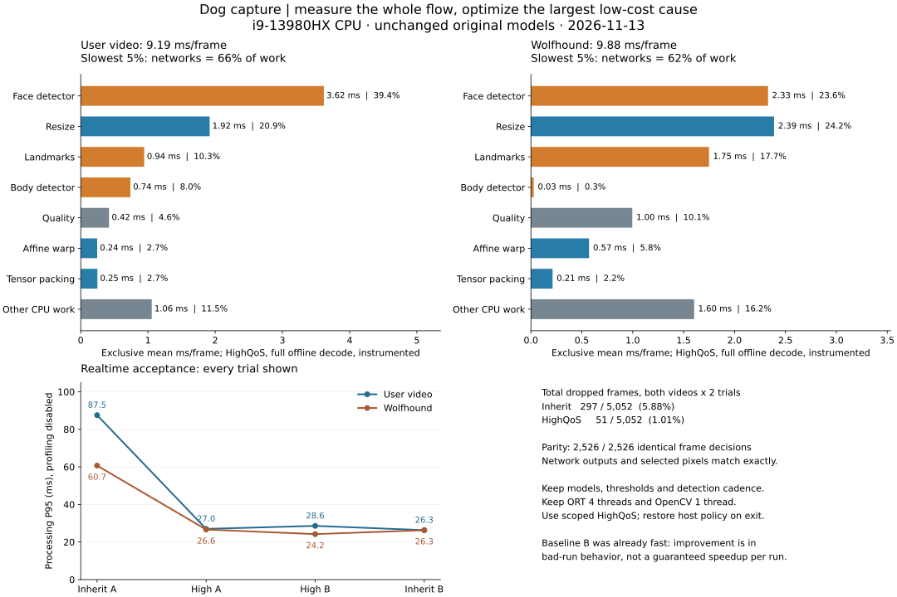
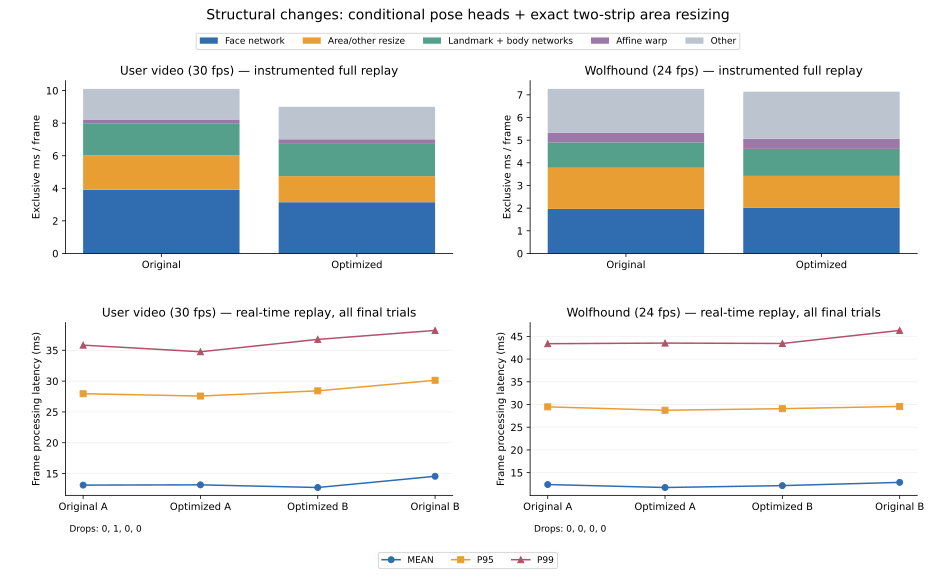
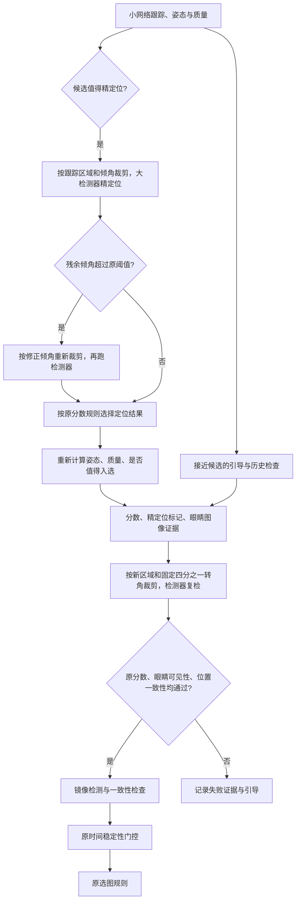
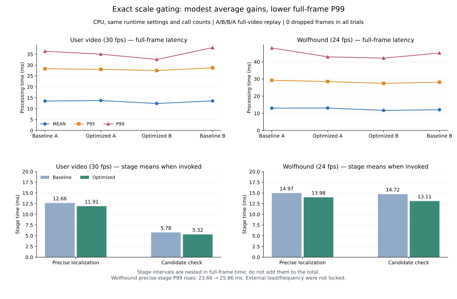

# 狗脸跟踪网络与“跟踪 / 精定位”两级机制（2026-11-12）

结论：慢的根源确实在网络和机制上。原来每一帧都用 YOLO-pose 检测器在 320 px 的裁剪上找关键点（单线程 WASM 每次约 104 ms），而且它看不了转过 45° 以上的脸，所以还要四个方向轮流试。现在改成两级：

- **每帧**用一个专门为裁剪训练的小网络（128 px）跟踪脸，单线程 WASM 每次约 9.5 ms，任何旋转角度一次就能读出朝向；
- **只在要选图的帧**上，用原来的检测器在跟踪网络已经摆正的裁剪上精定位一次，选图核实和服务端复检都用这份精定位结果。

浏览器引擎（onnxruntime-web WASM，本机，1280×720 帧）提速 1.5–2.7 倍；正面素材的结果不变，你的视频没有误收；**但雪纳瑞素材的侧脸会漏采**，所以目前是可选功能，模型文件放进模型目录才启用，默认行为与之前逐字节一致。

## 1. 为什么慢：每帧推理次数与单次耗时

| 网络（裁剪任务） | 128 px | 160 px | 320 px |
|---|---|---|---|
| 现用 YOLO11n-pose（完整检测头） | 25.5 ms | 29.3 ms | 104 ms |
| MobileNetV3-small | 6.3 ms | 8.9 ms | – |
| YOLO11n 骨干 + 小头（本次采用） | 7.6 ms | 17.6 ms | – |

（单线程 WASM，Node，随机权重测速。）原机制每帧还要额外的搜索：干净正面素材每帧 1.3 次检测器推理，难素材约 3 次。

## 2. 跟踪网络 `dog_face_landmarks.onnx`

- 输入 128 px 规范化裁剪（脸占 35%，与原来的裁剪约定相同）；骨干是 YOLO11n 第 0–9 层，用现有狗脸检测器的权重初始化（已经学过狗脸特征）；小 FPN 输出 8 张热图（soft-argmax 取坐标）。
- 输出：6 个关键点；脸框（中心、长边，给下一帧建裁剪）；是否有狗脸；每个点是否可见；**整圈的朝向**。
- 朝向的做法：关键点只在离正立 ±55° 以内训练（跟踪时裁剪每帧都已摆正）；另外两张热图——鼻子、两眼中点——在任意角度训练（这两个点没有左右之分，倒过来也认得出），由它们的连线算出朝向。直接让全局特征回归朝向不行（中位误差 35°，全局池化丢了空间布局）；全角度训练关键点也不行（10 轮只到 12%）。
- 训练：dogface6 训练集 6 773 张，随机平移/缩放模拟跟踪误差、颜色/模糊/JPEG、随机遮挡物（被盖住的点标成不可见）、非狗脸区域作负样本；CPU 上 80 轮约 40 分钟。
- 验证集（关键点误差 < 0.25 眼距算合格）：离正立 ±55° 以内的裁剪 **66%**；朝向中位误差 17°，71% 在 30° 以内。

## 3. 机制

1. 整图检测器只负责发现新脸（与原来相同的节奏）。
2. 跟踪：每张脸每帧跑一次跟踪网络。新脸或跟丢时：先跑一次读出朝向，再在摆正的裁剪上跑一次（共 2 次，原来 5–6 次）。
3. 选图候选（在位置带内、质量够、能改进当前槽位）：检测器在跟踪网络摆正的裁剪上跑一次（`FaceRefiner.precise`）。精定位的关键点必须仍然落在这个位置带里，判定规则与服务端复检相同（区间 ± `pose.exit_margin`、倾斜上限），否则记为 `view_unconfirmed`；质量、五官核实、时间稳定性和最终保存的照片都用精定位结果。五官核实（开环复查 + 镜像）仍用检测器，原来标定的阈值不变。
4. 候选失败（精定位、位置、五官、眼睛）后，这条轨迹 0.25 s 内不再尝试（`refine.candidate_retry_s`）；时间稳定性还在累积通过次数时不受此限制。两侧素材上这一条把单线程从 7.5 提到 9.3 fps。
5. 抗混叠：跟踪裁剪在视频近景里要缩小 6–18 倍（训练裁剪中位 2.6 倍），双线性点采样会混叠，模型看到的是随框的亚像素移动而跳动的噪声。现在缩小超过 2 倍时先对覆盖区域做面积平均，再以约 1:1 旋转裁剪（`refine.warp_crop`，几何误差 ≤ 0.01 px）。默认只用于跟踪网络的裁剪（`refine.antialias: tracker`）：检测器的裁剪若也改，原来的核实阈值要重新标定（试过 `all`：两侧素材右脸被服务端拒、你的视频端上收了不合格帧）。
6. 服务端复检：同样先跟踪网络、再精定位，模型随会话配置下发给浏览器（`models.landmarks`）。

## 4. 结果

浏览器引擎（TS，onnxruntime-web WASM，Node，本机；1280×720，15 fps 时间戳）：

| 素材 | 单线程：改前 → 改后 | 4 线程：改前 → 改后 |
|---|---|---|
| 正面小狗 | 6.0 → **13.1 fps** | 12.1 → **17.5 fps** |
| 雪纳瑞两侧 | 3.5 → **9.3 fps** | 8.0 → **18.7 fps** |

每帧检测器推理（原生 Python 引擎，同逻辑）：正面 1.29 → 0.26，两侧 2.49 → 0.70，你的视频 2.96 → 0.51；另加约 1 次跟踪网络。

验证集正面对比（400 张，整张图随机旋转，模拟跟踪框）：

| 流程 | 离正立 < 45° | 45–135° | > 135° | 全部 | 原生耗时 |
|---|---|---|---|---|---|
| 原来：四向搜索 + 重裁（检测器 5–6 次） | 62% | 57% | 73% | 62% | 83 ms |
| 只用跟踪网络（2 次） | 54% | 34% | 38% | 40% | 9 ms |
| **跟踪 2 次 + 精定位 1 次** | **72%** | 52% | 56% | 57% | 45 ms |

跟踪时脸一直接近正立，这正是精定位比原来更准的区间（72% 对 62%）；大角度靠朝向读数，还不如原来的四向搜索。

三段素材（按服务端复检）：

| 素材 | 原来 | 跟踪网络 |
|---|---|---|
| 正面小狗 | 正面通过 | 正面通过（10 fps 分析也通过） |
| 雪纳瑞两侧 | 右侧通过（左侧服务端不收） | **右侧漏采**；左侧端上收、服务端不收 |
| 你的视频 | 无 | 无，未误收不合格帧 |

浏览器端到端：比对场景通过（两张正面服务端都收），多下载 5 MB 模型，无控制台错误；建档场景仍不通过（左侧被服务端拒、右侧未采到）。

## 5. 还差什么

雪纳瑞侧脸漏采的原因：跟踪网络在这只狗的侧脸上 yaw 系统性偏大（中位 +0.13，抗混叠前 +0.18；正面素材只有 −0.05），位置状态在区间边缘来回跳，等不到停留确认。验证集上它的 yaw 反而略小（比值 0.85），所以不是一个比例系数能校正的。下一步按收益排序：

1. 用检测器在视频帧上的精定位结果蒸馏跟踪网络（大量无标注视频帧，正好覆盖近景和侧脸）；训练裁剪也按视频的缩小倍数做面积缩放。
2. 在 RTX 4060 上用更多轮次（本次 CPU 80 轮）、或输入 160 px（单线程 WASM 约 17.6 ms，仍是原来的 1/6）。
3. 位置判定用跟踪 yaw 时，按同一轨迹最近几次精定位的差值在线校正。
4. 跟踪模式下整图检测的节奏（现在 0.3 s）可以放宽到约 1 s，单线程还能再省约 15 ms/帧。

## 6. 使用

启用：把 `dog_face_landmarks.onnx` 和同名 `.json` 放进模型目录（`DOG_CAPTURE_MODELS`），或 `--landmarks 路径`，或配置 `refine.landmarks`；`off` 关闭。服务端会自动下发给浏览器。

训练与评估：

```bash
python src/Pet-ReID-IMAG/tools/train_dog_face_landmarks.py train --data <dogface6> --init <dog_face_pose 的 best.pt> --out runs/lm --epochs 80
```

```bash
python src/Pet-ReID-IMAG/tools/train_dog_face_landmarks.py export --init <同上 best.pt> --weights runs/lm/best.pt --output dog_face_landmarks.onnx
```

```bash
python src/Pet-ReID-IMAG/tools/benchmark_landmarks.py --data <dogface6> --detector dog_face_pose.onnx --landmarks dog_face_landmarks.onnx
```

浏览器与 Python 的一致性（真实模型）：`export_refine_parity.py --landmarks dog_face_landmarks.onnx …`，再用 `DOG_CAPTURE_REAL=<目录> npx vitest run test/real-models.test.ts`。

## 7. 视频蒸馏首轮实测与 checkpoint 归档（2026-11-13）

已基于 `3dd87c3` 接通视频下载、教师标注、权重恢复、GPU 微调、ONNX 导出、原生回放与 SDK 一致性验证。**首轮候选尚未通过替换基线的验收**：在 Wolfhound 上 yaw 偏差有所下降，但验证集整体关键点误差和实时回放丢帧都出现回归。完整机器可读结果见 `assets/dog_capture/video_distillation_pilot_result.json`。

### 模型长期存放位置

项目根目录下保留两套独立文件，不再依赖用户的 Downloads 目录：

| 用途 | 路径 |
|---|---|
| 用户提供的原始 ONNX 与 JSON | `models/pretrained/dog_capture_landmarks_v1/dog_face_landmarks.onnx`、同名 `.json` |
| 从原 ONNX 恢复的可训练权重 | `models/pretrained/dog_capture_landmarks_v1/recovered_trainable.pt` |
| 原始模型来源与文件哈希 | `assets/dog_capture/landmark_checkpoint.json`；归档目录内另有 `archive_manifest.json` |
| 首轮实验候选 | `models/pretrained/dog_capture_landmarks_video_pilot_20261113/dog_face_landmarks.onnx`、同名 `.json`、`best.pt` |
| 候选验收结果 | 候选归档目录内 `acceptance.json` |

原 ONNX SHA256 为 `1fb6ad2185d0e4d65addf62c1d5fd79f32f84e61e62ae0dd9694609ca7cc1171`。
它包含推理权重，没有原优化器状态。`import_dog_landmark_weights.py` 按原导出结构恢复可训练参数，保留已经融合的 Conv/BN，拒绝未映射的权重；12 组输入与原 ONNX 最大绝对输出差为 `0.0000534`。这是可验证的微调起点，不是恢复原训练进度。

这些二进制与视频按现有仓库约定保留在本地归档，Git 跟踪脚本、来源清单、哈希和实验结果。启用任一版本时使用明确的 `refine.landmarks` 路径或 `--landmarks`，实验工具不会自动替换运行中的模型。

### 数据与训练约束

来源、作者、许可、下载地址、内容哈希和固定拆分均在 `assets/dog_capture/video_distillation_sources.json`。视频来自 Wikimedia Commons，先看内容，再按整段视频及狗分组；镜像里的同一只狗和同一视频里的多只狗不能跨训练与验证。用户视频和已有 Wolfhound 视频只作回归检查。

筛查了 15 段新下载短片，选取其中 8 段进入标注；其中 2 段没有产生合格标签。实际训练来自 4 段视频，共 **159 帧**，验证来自另外 2 段，共 **45 帧**；受保护回归视频留下 116 帧。连续近似重复帧会去重，采样按视频与姿态平衡，不能把相邻帧拆到训练、验证两边。

教师固定使用 320 px 检测器，关闭跟踪网络，进行规范裁剪、四方向搜索、开环复查、镜像与轻微平移的一致性检查，并检查眼部图像证据。单点不稳定或被遮挡时屏蔽该点的坐标监督；远侧眼没有支持时也屏蔽 yaw 及双眼中点监督。被拒绝的帧不会自动变成“没有狗”的负样本。

**这批视频的有效侧脸覆盖仍然不足**：159 个训练样本中只有 5 个侧脸样本，其中仅 1 个的双眼与鼻子同时得到支持；验证集没有可靠的侧脸 yaw 标签。镜像增强可以变换方向，不能增加独立狗或独立侧脸的证据。因此该轮不能验证普遍侧脸精度。

另对 Africanis 转头片段的 8 帧检查了 0.35 / 0.45 / 0.55 / 0.65 四种教师裁剪占比；32 组中只有 1 组正面通过一致性筛选，没有补回可靠侧脸（`teacher_scale_probe.json`）。扩大教师裁剪中的脸部比例不足以修正这组样本的远侧眼标注。

微调保持 128 px 输入、35% 脸部占比、24 维输出和原网络结构；训练裁剪直接调用部署用的 `warp_crop(..., antialias=True)`。冻结骨干、存在性、可见性与脸框分支，只更新 FPN 和热图的 107,336 个参数，用原模型约束无监督点及任意旋转方向。RTX 4060 上训练 12 轮，按整段验证视频等权的 NME 与 yaw MAE 之和选择第 4 轮，同时单独报告关键点回归和缺少侧脸验证的问题；综合分下降不等于允许部署。

### 精度与采集结果

下表是**相对教师伪标签的误差，不是人工真值精度**。NME 以教师眼距归一化，yaw 是无量纲比例，不是角度。

| 范围 | 指标 | 原模型 | 候选 |
|---|---|---:|---:|
| 独立验证视频，45 帧 | 平均 NME | 0.1396 | 0.1530 |
| 独立验证视频，44 个支持 yaw 的帧 | yaw MAE | 0.0752 | 0.0641 |
| Wolfhound 回归视频，113 帧 | 平均 NME | 0.1868 | 0.1717 |
| Wolfhound，62 个支持 yaw 的帧 | yaw MAE | 0.1204 | 0.0847 |

原始用户视频 1,314 帧、Wolfhound 1,212 帧及空场景、模糊场景均完整回放。用户视频、空场景和模糊场景都未选图。Wolfhound 离线回放原版选中正面、左侧，候选额外找到了右侧候选；但该右侧图眼睛状态不可靠，独立复检在无损像素上拒绝、JPEG95 上通过，不能以其中一次通过作为验收结论。实时丢帧改变采样后原版也能产生右侧候选，离线覆盖差异不能直接当作采集成功率提升。

### 速度与稳定性

CPU 为 i9-13980HX，GPU 为 RTX 4060 Laptop。单次跟踪调用在相同的 32 张真实裁剪上交替测原版/候选，各 600 次，包含 RGB 转换、同步推理、GPU 传输及输出解析：

| 后端 | 原版平均 / P95 | 候选平均 / P95 |
|---|---:|---:|
| CPU，4 线程，关闭空闲忙等 | 1.38 / 2.38 ms | 1.21 / 2.02 ms |
| CUDA FP32 Graph | 1.22 / 2.67 ms | 1.22 / 2.67 ms |

**单模型耗时不代表完整实时采集耗时。** 按视频原始节奏回放，保留检测、身体门控、方向、跟踪、选图及容量为 1 的工作队列，单轮 CPU 结果如下；不同回放的设备状态和采样也会影响测量，不把这些数值当作稳态速度优劣定论。

| 视频 | 原版 P95 / 丢帧率 | 候选 P95 / 丢帧率 |
|---|---:|---:|
| 用户视频，30 fps | 71.56 ms / 11.72% | 90.56 ms / 22.53% |
| Wolfhound，24 fps | 49.81 ms / 2.72% | 78.86 ms / 6.77% |

本次也修复了 `benchmark_dog_capture_v1.py` 的漏测：原来回放时重新构建 `CaptureEngine` 未传入已经加载的 landmarker，实际又走了检测器跟踪。现在回放显式传入它，校验其执行后端，记录模型哈希和各模型调用次数。模型级测速使用新的 `benchmark_dog_landmark_pair.py`；两种计时口径分开报告。

### 复现入口

在包含本提交的仓库目录下运行；先按训练设备安装 PyTorch，再安装 `requirements-dog-landmark-training.txt`。已有归档无需再次导入。需要从另一个原始 ONNX 建立训练起点时：

```bash
python src/Pet-ReID-IMAG/tools/import_dog_landmark_weights.py --onnx models/pretrained/dog_capture_landmarks_v1/dog_face_landmarks.onnx --output models/pretrained/dog_capture_landmarks_v1/recovered_trainable.pt
```

公共视频下载及标注：

```bash
python src/Pet-ReID-IMAG/tools/fetch_dog_distillation_assets.py --manifest assets/dog_capture/video_distillation_sources.json --root .
python src/Pet-ReID-IMAG/tools/prepare_dog_video_distillation.py --manifest assets/dog_capture/video_distillation_sources.json --root . --teacher models/pretrained/dog_capture_v1/dog_face_pose.onnx --out data/dog_capture/distillation/pilot_v2 --sample-fps 4 --max-per-video 200
```

标注目录保留原帧、逐点权重、拒绝计数、来源快照和 `audit_train.jpg` / `audit_val.jpg` / `audit_test.jpg`，先检查侧脸覆盖与叠加点位再训练。以下工具拒绝覆盖现有数据、训练目录或 checkpoint；重做实验需更换输出路径。

```bash
python src/Pet-ReID-IMAG/tools/train_dog_video_landmarks.py --data data/dog_capture/distillation/pilot_v2 --weights models/pretrained/dog_capture_landmarks_v1/recovered_trainable.pt --out artifacts/runs/dog_capture/video_distillation_20261112/train_pilot_v1 --device cuda --epochs 12 --repeats 4 --batch 16 --lr 0.00005
python src/Pet-ReID-IMAG/tools/benchmark_dog_landmark_pair.py --data data/dog_capture/distillation/pilot_v2 --baseline models/pretrained/dog_capture_landmarks_v1/dog_face_landmarks.onnx --candidate models/pretrained/dog_capture_landmarks_video_pilot_20261113/dog_face_landmarks.onnx --output artifacts/runs/dog_capture/paired_cpu.json --providers cpu
```

导出后进行了 ONNX checker 和 16 张真实裁剪的 PyTorch/ORT 对照，最大输出差 `0.0000305`。Python 测试 103 项通过；SDK 34 项通过、1 项因缺少独立检测器参考照片而跳过，其中候选模型的 4 帧真实 Python/WASM refinement 对照实际运行并通过。速度、连续回放、独立选图复检和测试日志保存在 `artifacts/runs/dog_capture/video_distillation_20261112/`。

下一轮应按内容补数据：以 6–10 只不同狗的短片为小规模采集目标，包含清楚的“正面—左转—正面—右转”、近景及侧躺；先确认左右两侧都有可靠眼鼻标注，再增加帧数。对教师持续放错的远侧眼或闭眼帧，补少量校正锚点及可见性标签。这个数量是采样目标，不是精度保证；回归视频继续隔离，新增侧脸验证视频后再选 checkpoint。

## 8. CPU 开销复核与输入打包优化（2026-11-13）

此前候选模型在用户视频上的一次实时诊断为平均 33.39 ms，其中三个模型的 `_run` 调用合计摊到每帧 22.69 ms。这是 CPU 墙钟耗时，包含 ORT 执行、线程调度/同步和输入布局处理，并非 GPU 耗时或纯算术耗时。输入转换/输出解析差额还包括检测器的 letterbox 缩图；其余差额也不能全部归为跟踪关联。

改动代码之前，保持同一视频、候选权重、4 个 ORT 线程、关闭忙等、1 个 OpenCV 线程再次实时测量：1,314 帧中处理 1,311 帧，平均处理 13.91 ms，P95 30.61 ms；三个模型调用摊到每帧合计 7.76 ms。跟踪关联 0.20 ms，姿态 0.07 ms，质量评估（含对齐、像素指标）1.00 ms。该结果与前次差距大，不能把它记作代码优化收益或稳定实时承诺；设备状态/调度变化的具体成因尚未隔离。

该次复测的网络调用如下；均为 CPU `_run` 墙钟时间：

| 模型 | 输入 | 调用次数 / 处理帧 | 平均每次 | 摊到每帧 |
|---|---|---:|---:|---:|
| 脸部检测器（含精定位/复检） | 320×320 | 631 / 1,311 | 10.30 ms | 4.96 ms |
| 身体检测器 | 416×416 | 144 / 1,311 | 8.83 ms | 0.97 ms |
| 跟踪关键点 | 128×128 | 1,222 / 1,311 | 1.96 ms | 1.83 ms |

图像操作中，所有 `resize` 合计摊到每帧 2.88 ms，所有 `warpAffine` 0.33 ms。近景跟踪裁剪经常需要把原始 720×1280 画面做面积平均再仿射采样，不能按“只处理 128×128”估算成本。这些操作已计入裁剪、预处理或质量评估，不能再与父级计时相加。关闭抗锯齿会改变训练/部署输入，本次保留原采样方法。

已优化 `_rgb_tensor`：直接将 BGR 通道以 FP32 写入最终连续 NCHW 张量，避免 RGB/HWC 临时数组、独立减法/乘法数组及 ORT 的布局复制。非零均值仍先减后乘，保持原数值舍入顺序。320×320 连续打包的交替微测为 **1.067 → 0.497 ms**；128×128 微测本身没有加速（0.022 → 0.024 ms），不将大尺寸收益外推到小跟踪模型。

使用归档原版跟踪权重，以同一组模型会话、独立采集状态，在每一帧交替运行新旧打包实现，完整离线核对两段视频：

| 视频 | 帧数 | 旧 / 新平均帧处理 | 旧 / 新 P95 |
|---|---:|---:|---:|
| 用户视频 | 1,314 | 12.04 / 11.28 ms | 30.26 / 28.41 ms |
| Wolfhound | 1,212 | 8.26 / 7.94 ms | 25.55 / 23.33 ms |

两段共 2,526 帧、每种实现各 3,477 次模型调用：原始网络输出逐元素相同，排除计时后的逐帧结果和最终选图相同。以上为同帧离线 A/B，不是实时采集 FPS。8 项新增测试覆盖全部 uint8 值、RGB 通道顺序、负步长/非连续输入、SCRFD 非零均值和连续输出；相关 Python 测试共 111 项通过。

诊断与回归原始记录在本地 `artifacts/runs/dog_capture/video_distillation_20261112/` 的 `component_profile_deep_candidate_cpu.json`、`paced_all_models_probe.json`、`rgb_tensor_probe.json`、`rgb_capture_parity.json`；精简结果跟踪于 `assets/dog_capture/rgb_packing_benchmark.json`。本改动没有切换实验候选模型；下一步仍需控制设备状态，并减少跟踪失稳导致的全帧检测调用，分开验证线程策略和候选复检调度。

## 9. 复检短路与 CPU 实时线程配置（2026-11-13）

### 精度约束下减少调用

复检先在固定四分之一转角的裁剪上检测，再检查镜像。以前即使第一遍的置信度、眼睛可见性或与原关键点的一致性已经不合格，也会运行镜像网络。现在 `FaceRefiner.verify(..., front=...)` 在这些原有拒绝条件命中时立即结束，记录 `mirror_skipped`；镜像误差记为不可用，保持拒绝。可接受候选仍运行完整镜像检查，阈值、采样、重捕获周期和时间门控均保持原值。Python 与浏览器 SDK 同步实现；训练和导出工具不传 `front`，仍取得完整诊断值。

逐帧调用统计：用户视频的脸部网络 **649 → 628 次**，Wolfhound **291 → 286 次**，合计减少 26 次。被检查片段中的镜像调用 **57 → 31 次**；这不是全部检测调用减少 46%。同一帧相同输入的重复推理没有出现，因此未增加输入缓存。用户视频仍有大量无可靠跟踪区域时的全帧检测；保留这些调用来维持原来的重捕获能力。

### 线程策略与兼容性

增加运行时选项 `spin_duration_us` 与 `spin_backoff_max`，同时传给脸部检测器、身体检测器及跟踪网络，普通会话和 CUDA Graph 会话都能使用并在运行信息中报告。旧配置默认 `-1 / 1`，保持原有行为；显式关闭 `thread_spinning` 时仍完全关闭忙等。新配置在 ORT 1.26 上验证，旧版本若请求新策略会明确报错，避免静默忽略限时选项。

本机保留 **4 个 ORT 线程、1,000 μs 忙等窗口、退避上限 8**，OpenCV 使用 1 个线程。依据 [ONNX Runtime 官方线程配置](https://onnxruntime.ai/docs/performance/tune-performance/threading.html#thread-spinning-behavior)，限时窗口允许相邻算子复用活跃线程，同时结束空闲忙等；未更改系统电源计划、进程优先级或其他程序。两线程筛查的用户视频 P95 为 75.54 ms、丢 164 帧，未采用。没有做功耗测量，不把限时忙等等同于已证明能耗下降。

`run` 命令默认使用一个 OpenCV 线程，并在结果统计里记录线程数；可用 `--cv-threads` 覆盖，0 保留环境默认值。这个设置仅由独立命令行入口应用，库的 `build_engine` 不改宿主程序的全局 OpenCV 设置。嵌入其他应用时，宿主应自行选择并记录 OpenCV 线程数。

`assets/dog_capture/cpu_realtime.json` 是可合并到现有模型配置的运行时预设，不覆盖模型路径、精度阈值或选图等级。命令行也可直接覆盖这些选项：

```bash
python -m dog_capture run VIDEO --config existing_capture.json --providers cpu --threads 4 --thread-spinning --spin-duration-us 1000 --spin-backoff-max 8 --realtime
```

本机包含归档原版跟踪权重、检测器绝对路径和这组运行时参数的完整配置保存在 `artifacts/runs/dog_capture/runtime_optimization_20261113/cpu_realtime_config.json`。该配置使用原版 checkpoint，不启用未通过精度验收的蒸馏候选。

### 完整逐帧回归

新增 `tools/compare_dog_capture_runtime.py`，加载对照 checkout 的 `engine.py` 和 `refine.py`；模型适配器保持一致，原版/优化版使用各自线程配置及独立模型会话、跟踪状态，逐帧交替先后顺序。每次模型运行按输入张量哈希匹配原始输出哈希，要求优化版执行的模型调用均有完全一致的原版输出。比较未舍入的框、关键点、yaw、roll、质量分，以及排除计时后的全部逐帧结果；只对明确已拒绝候选忽略未计算的镜像诊断值。

用户视频 1,314 帧与 Wolfhound 1,212 帧全部通过：**零数值/判定差异，最终选图及原图、对齐图的像素哈希一致**。用户视频均未选图，Wolfhound 均选中正面、左侧；没有以放宽侧脸或闭眼规则换取帧率。完整结果在 `runtime_optimization_20261113/equivalence_final/result.json`。原版对照提交为 `60bfc8c`。

复现时先建立该提交的独立 checkout，再运行（路径按设备替换；输出目录必须新建）：

```bash
python src/Pet-ReID-IMAG/tools/compare_dog_capture_runtime.py --reference-root OLD_CHECKOUT --config BASELINE_CONFIG --optimized-config assets/dog_capture/cpu_realtime.json --source USER_VIDEO --source WOLFHOUND_VIDEO --output NEW_OUTPUT
```

相关 Python 测试 127 项通过；SDK 39 项通过、1 项因缺少独立检测照片参考而跳过，真实模型四帧 refinement 对照实际运行，TypeScript 类型检查通过。边界测试覆盖正面/侧面眼睛规则、阈值相等、失败原因、旧 ORT 兼容性和选项传递。

另对 I/O 与采集服务运行了 20 项通过、1 项因未安装可选 Brotli 包而跳过的测试；原生 CLI 以完整本机配置实际回放前三秒并生成报告，确认 OpenCV 单线程配置生效。未选出照片时 CLI 按原约定返回非零状态，不代表运行异常。

CLI 保持原来的每模型 2 次预热；上述启动检查处理 82 / 91 帧，27.14 FPS、P95 42.40 ms。下述完整视频测试预热 15 次，启动前三秒的表现不能用完整回放的平均速度替代。

### 两轮实际实时回放

CPU、原始视频 PTS、容量为 1 的处理队列，逐轮完整解码；两种版本各回放两段视频两次。顺序为原版 A、优化 A、优化 B、原版 B，B 轮反转视频顺序；所有推理测试串行执行。每个模型预热 15 次，排除预览/UI、网络、ReID 及最终文件保存，计入检测、方向、跟踪、质量和选图；响应延迟另计入生产者迟到和排队。A/B 轮之间存在参数筛查和精度验证，未锁定系统负载或 CPU 频率，因此给出全部轮次而非只选最快一轮。

| 视频 | 原版 FPS 范围 | 优化 FPS 范围 | 原版 P95 范围 | 优化 P95 范围 | 两轮丢帧：原版 → 优化 |
|---|---:|---:|---:|---:|---:|
| 用户视频，30 fps | 24.17–29.34 | 29.82–30.00 | 29.67–82.88 ms | 28.61–30.38 ms | 283 → 8 / 2,628 帧 |
| Wolfhound，24 fps | 23.54–24.01 | 23.95–24.01 | 28.68–35.56 ms | 28.53–30.00 ms | 24 → 3 / 2,424 帧 |

两段合计丢帧 **307 / 5,052（6.08%）→ 11 / 5,052（0.22%）**。合并两轮处理帧的 P99：用户视频 **106.99 → 40.09 ms**，Wolfhound **61.37 → 46.15 ms**。优化后各轮从计划输入时刻到结果的 P95 为 29.95–31.60 ms。不是所有单轮指标都变快（例如 Wolfhound B 轮 P99 为 50.23 ms，原版 B 为 44.66 ms）；收益主要在坏轮次和总丢帧的收敛，不能宣称消除了操作系统长尾。

实时丢帧会改变时间门控和选图：原版 A 的 Wolfhound 额外出现右侧候选，其余原版/优化轮次为正面、左侧；用户视频各轮均未选图。精度回归使用完整相同输入帧单独验证，不把实时采样差异当作模型精度变化，也不把多一张候选直接当作更准。

全部单轮结果、模型哈希、运行时参数、聚合方法与逐帧回归结论在 `assets/dog_capture/runtime_optimization_benchmark.json`。原始 `summary.json`、逐帧计时与所选 PNG 保存在本地 `artifacts/runs/dog_capture/runtime_optimization_20261113/{baseline_a,optimized_a,optimized_b,baseline_b}`。本次主要收益来自运行时线程策略；精度约束下省去的 26 次大网络调用是较小但可验证的额外收益。

## 10. 先按完整数据流排序，再优化大头（2026-11-13）

新增 `tools/profile_dog_capture_flow.py`：在独立诊断进程中临时安装嵌套计时，保留每帧调用路径、调用次数、包含子步骤的耗时和扣除子步骤后的独占耗时。后者逐帧加总必须等于整帧时间，避免把裁剪、网络、复检重复相加。常规运行不安装计时钩子；钩子退出或异常时恢复。

剖析覆盖视频解码、生产者迟到、工作队列等待、输入整理、全图检测、ROI 重捕获、跟踪裁剪与关键点网络、跟踪关联、物种门控、姿态、质量、精定位、镜像复检及选图。解码在生产者线程上，可与工作线程重叠，不能直接把解码平均时间加到帧处理时间。ORT 调用是含运行时与同步的墙钟耗时。测试关闭预览、网络与 ReID，最终图片保存也单独放在计时之后。

输出包括 `profile.json`（统计与调用树）、`frames.json.gz`（逐帧嵌套区间）、`trace.json.gz`（Chrome trace 格式，真实单调时钟轴，分生产者/工作线程）、`components.png/svg`（独占耗时与最慢 5% 帧）以及 `flow.png/svg`（完整累计调用树）。调用树横向布局表示累计开销，不是某一帧的实际执行顺序；实际顺序应看逐帧区间或 trace。

两段完整视频的离线和实时剖析表明，网络执行占整帧约 **40%–59%**，缩放占 **19%–28%**，输入打包只有 **2%–3%**。最慢 5% 帧里，网络执行合计约占 **66%–68%**。缩放主要来自近景跟踪裁剪中的面积平均；用户视频的大网全图调用为 539 / 628 次，Wolfhound 为 152 / 286 次。候选验证会制造局部高峰，但不能把它当作所有场景的最大累计开销。

候选按收益上限、实现成本和精度风险统一排序：

| 候选 | 覆盖的开销 | 筛查与决定 |
|---|---|---|
| CPU 进程调度提示 | 同时影响网络、缩放和其他 CPU 计算 | 采样发现调用线程大量落在效率核；显式 HighQoS 有收益，纳入完整回归 |
| 网络线程 4 → 1 / 2 | 网络是最大累计开销 | 真实输入的交替筛查更慢，不采用；脸部网络还出现约 3–5e-5 原始输出差异 |
| OpenCV 线程 1 → 2 / 4 | 缩放是第二大累计开销 | 抽样像素完全一致，但没有稳定速度收益，不采用 |
| HighQoS 再加性能核绑定 | CPU 调度 | 没有稳定附加收益，不增加绑定与拓扑适配逻辑 |
| 缩短大网调用链、异步候选验证 | 对慢帧有价值 | 改动成本与时序风险更高，留在后续队列；本次保持原采集判定顺序 |
| 融合抗锯齿缩放或改变重捕获策略 | 覆盖缩放/全图检测 | 需要独立输入等价性或召回验证，不能靠改采样和跳帧直接降低精度 |
| 仅将 RGB 打包移入 ONNX | 只有 2%–3% 的整帧开销 | 收益上限低，优先级后移 |

实际采用的是 Windows 进程级 `ProcessPowerThrottling` 执行速度提示：设置 HighQoS，保留其他策略位，在作用域结束（含异常）时恢复原策略。[Microsoft 官方 API](https://learn.microsoft.com/en-us/windows/win32/api/processthreadsapi/nf-processthreadsapi-setprocessinformation) 说明系统可能通过频率与核选择调整后台任务的 QoS。初始策略的 ControlMask 为 0，表示系统自行判断；不能据此宣称进程之前被显式设置为 EcoQoS。改动不设置 CPU 亲和性，也不改变优先级类别；没有做功耗测量。

独立 CLI 的 `run` 新增 `--cpu-qos auto|inherit|high`。默认 `auto` 仅在 Windows 实时文件回放或实时输入期间请求 HighQoS；离线处理和其他平台保持继承。结果的 `stats.cpu_policy` 记录请求、实际读回的策略或自动请求失败原因。显式 `high` 不可用时直接报错。基准和剖析工具默认 `inherit`，用 `--cpu-qos high` 明确选择优化组。

库的 `build_engine()` 不改变宿主进程策略。嵌入时由宿主在入口统一决定，可用以下作用域（不要从并发工作线程各自设置进程策略）：

```python
from dog_capture.engine.process_policy import cpu_qos

with cpu_qos('auto', realtime=True) as cpu_policy:
    # 在这个作用域里创建模型、采集和处理；结束后恢复进入时的策略。
    run_capture()
```

复现完整耗时图：

```bash
python src/Pet-ReID-IMAG/tools/profile_dog_capture_flow.py --config CAPTURE_CONFIG --source USER_VIDEO --source WOLFHOUND_VIDEO --playback both --cpu-qos inherit --output NEW_BASELINE_DIR
python src/Pet-ReID-IMAG/tools/profile_dog_capture_flow.py --config CAPTURE_CONFIG --source USER_VIDEO --source WOLFHOUND_VIDEO --playback both --cpu-qos high --output NEW_OPTIMIZED_DIR
```

原始剖析、线程筛查、CPU 核采样和完整视频回归记录保存在本机 `artifacts/runs/dog_capture/flow_optimization_20261113/`。计时插桩会增加开销，最终速度验收使用关闭插桩的 `benchmark_dog_capture_v1.py`，不用剖析图上的 FPS 宣称生产速度。

### 优化后仍然占大头的位置



完整累计调用树：[用户视频](../assets/dog_capture/flow_profile/user_flow.svg)、[Wolfhound](../assets/dog_capture/flow_profile/wolfhound_flow.svg)。这两张图使用全帧离线输入，确保两组视频各自没有因实时丢帧改变工作量。图中父级包含子级，横坐标单位是平均每帧毫秒；小块的完整名称与逐次时间在 `profile.json` 和 trace 中。

以下是 HighQoS 后完整离线剖析的独占耗时；处理均值分别为 9.19 / 9.88 ms，带计时钩子，不能直接当作实时延迟：

| 独占步骤 | 用户视频，ms / 帧 | Wolfhound，ms / 帧 |
|---|---:|---:|
| 脸部大网，合计各调用入口 | 3.62 | 2.33 |
| 所有缩放 | 1.92 | 2.39 |
| 关键点网络 | 0.94 | 1.75 |
| 身体网络 | 0.74 | 0.03 |
| 质量评估的其余计算 | 0.42 | 1.00 |
| 仿射采样 | 0.24 | 0.57 |
| 输入打包 | 0.25 | 0.21 |
| 其余控制、姿态、关联等 | 1.06 | 1.60 |

合并离线/实时剖析范围，网络仍占 **40%–58%**、缩放 **21%–26%**，输入打包 **2%–3%**。最慢 5% 帧中的网络占比约 **61%–66%**。因此调度调整之后，后续结构工作仍应围绕网络调用链和近景裁剪，而不是转向小数组转换。

缩放大头已经定位到 `refine → examine → crop → warp_crop → resize`：用户视频 1,112 次、摊到每帧 1.07 ms；Wolfhound 1,212 次、每帧 1.90 ms。下一步优先调查这一路能否共享**完全相同采样定义**的工作，再考虑更复杂的融合。不能先删掉抗锯齿后用帧率证明优化。全图检测和异步候选验证的理论收益更大，但需要重捕获召回与时间门控验证；当前没有经过验证的低成本实现，因此本轮不改变调用周期或判定顺序。

### 本轮实际实时 A/B 验收

同一台 i9-13980HX，CPUExecutionProvider，原始模型，4 个 ORT 线程、1,000 μs 限时忙等、退避 8、1 个 OpenCV 线程。基准预热每模型 15 次，使用视频 PTS 与容量为 1 的生产队列。顺序为继承 A → HighQoS A → HighQoS B → 继承 B；B 轮反转视频顺序。两组唯一生产行为差异为进程 QoS，各推理任务串行执行。未锁定系统负载或 CPU 频率，全部轮次如下：

| 策略 / 轮次 | 用户视频 FPS | 处理 P95 | 丢帧 / 1,314 | Wolfhound FPS | 处理 P95 | 丢帧 / 1,212 |
|---|---:|---:|---:|---:|---:|---:|
| 继承 A | 24.26 | 87.53 ms | 251 | 23.08 | 60.68 ms | 46 |
| HighQoS A | 29.73 | 26.98 ms | 12 | 23.82 | 26.64 ms | 10 |
| HighQoS B | 29.52 | 28.60 ms | 21 | 23.85 | 24.20 ms | 8 |
| 继承 B | 30.01 | 26.32 ms | 0 | 24.01 | 26.30 ms | 0 |

合计丢帧 **297 / 5,052（5.88%）→ 51 / 5,052（1.01%）**。按所有处理帧合并后计算，用户视频 P95 **59.16 → 27.18 ms**、P99 **135.33 → 44.52 ms**；Wolfhound P95 **44.01 → 25.28 ms**、P99 **78.06 → 50.21 ms**。HighQoS 各轮从计划视频时刻到结果的 P95 为 **25.44–31.50 ms**。

继承 B 已经很快，部分指标优于 HighQoS；本轮证据支持减少较差轮次和长尾，不能声称每次都加速或消除调度抖动。HighQoS 中仍有约 236 / 250 ms 的最大单帧值，最大延迟没有硬上界。此处所有速度均是 CPU 采集处理测量，未包含预览、UI、网络、ReID 和最终图片保存。

实时采样差异会影响选图：Wolfhound 的继承 A 与 HighQoS B 均出现右侧候选，其他两轮为正面、左侧；具体帧号记录于结果 JSON。用户视频各轮均未选图。最终精度验收另用完整相同帧，避免把队列丢帧造成的候选变化当成数值或模型精度变化。

### 数值、判定与入口回归

以 `d870074f7d9eb5b3a00ca7414bfa3d8e53d78c87` 为对照，在每帧交替先后运行继承策略与 HighQoS，所有 **2,526 帧零差异**。检查包括原始网络输出哈希、未舍入的框/关键点/姿态/质量分、排除计时后的完整逐帧结果和最终图片像素哈希。模型调用数也完全相同：用户视频脸部 / 身体 / 关键点 **628 / 125 / 1,178** 次，Wolfhound **286 / 1 / 1,233** 次。最终离线选图均为用户视频无图、Wolfhound 正面第 20 帧与左侧第 278 帧。模型、采样、阈值和检出周期都未改动；这证明本轮改动在这两段输入上的回归一致性，不代表扩展数据集的模型准确率。

比较工具兼容新旧对照提交：当两边已经都有 `mirror_skipped` 时，完整比较该诊断字段；只有旧对照确实没有短路字段时才使用原有归一化逻辑。新增回归覆盖同字段、不同原因及旧版对照，避免测试工具误报或掩盖差异。本轮最终严格核对没有归一化任何镜像诊断字段。

```bash
python src/Pet-ReID-IMAG/tools/compare_dog_capture_runtime.py --reference-root D870074_CHECKOUT --config CAPTURE_CONFIG --optimized-config assets/dog_capture/cpu_realtime.json --reference-cpu-qos inherit --optimized-cpu-qos high --source USER_VIDEO --source WOLFHOUND_VIDEO --output NEW_EQUIVALENCE_DIR
python src/Pet-ReID-IMAG/tools/benchmark_dog_capture_v1.py --config CAPTURE_CONFIG --source USER_VIDEO --source WOLFHOUND_VIDEO --providers cpu --threads 4 --cv-threads 1 --cpu-qos high --stage video --playback realtime --warmup 15 --repeats 1 --samples 4 --output NEW_BENCHMARK_DIR
```

基准中的 `CAPTURE_CONFIG` 应包含上文完整的限时忙等参数与原版模型路径；对照将 `--cpu-qos high` 换为 `inherit`，第二轮交换视频顺序。每轮使用新输出目录。

主回归 **148 项通过、1 项因缺少可选 Brotli 包跳过**；比较器修正后相关 4 项通过（其中 3 项已包含在主回归中），总计 149 项不同测试通过。测试覆盖计时自耗时核对、工作线程追踪、异常恢复、QoS 的自动启用/跨平台/失败行为及宿主策略恢复。

原生 `python -m dog_capture run ... --realtime` 默认 `auto` 的实际前三秒检查：读取并处理 **91 / 91 帧、零丢帧、处理 P95 25.99 ms**，策略读回为 HighQoS，OpenCV 为 1 线程，原视频帧数正确记录为 1,314。使用 CLI 原有每模型 2 次预热；没有合格照片时按既有约定返回 2，报告正常生成。所有原始记录和精简汇总在 `flow_optimization_20261113/`；随代码提交的可审阅结果为 [flow_profile_benchmark.json](../assets/dog_capture/flow_profile_benchmark.json)。

## 11. 网络分支与近景面积缩放的结构优化（2026-11-13）

本轮以 `f170e36911762bb2a5bb4ad2e7b1202cfbbb8e3a` 为完整对照，两边都使用上一节已验收的 HighQoS、4 个 ORT 线程、1,000 μs 忙等窗口、退避 8 和 1 个 OpenCV 线程。改动集中在网络内部的执行依赖和缩放的任务拆分。

### 先筛查覆盖面

两段视频完整审计发现，同帧相同输入的重复网络调用为零；面积缩放的相同请求只有 30 / 2,076 和 16 / 1,649 次。输入缓存的覆盖面太小，没有增加缓存和失效管理。将图像改成 BGRA、逐通道缩放、平面排列的实验也没有采用：虽然像素一致，整体比原始 BGR 缩放慢约 2–3 倍。

用户视频 628 次脸部调用中有 477 次没有分数达到原阈值；Wolfhound 为 1 / 286 次。因此网络优化应根据原分数条件省去无用分支，而不是降低全帧检测频率。后者会影响重新捕获，前者不改变任何检测机会。

### 无候选时省去框与关键点分支

新增 `tools/compile_dog_capture_cpu.py`。先让 ORT 在部署 CPU 上完成原图优化，再保留分数及其共享祖先节点，在原有框与关键点分支外加 ONNX `If`。全部原分数均低于本次调用的阈值时，返回 `[1, 23, 0]` 空候选；只要有分数达到阈值，就运行全部原分支并返回完整原始 anchors。等于阈值保留，阈值是运行时输入，NMS 顺序不变。先比较每个分数再归约布尔结果，避免 NaN 掩盖另一有效候选。

本机图中 251 个分数/共享节点常规运行，68 个框/关键点节点按条件运行。只是改变计算依赖，没有改变权重、精度格式、网络输入尺寸或阈值。直接在未优化 ONNX 上加 `If` 的初版被否决：正样本慢约 8%–11%，原始输出出现最高约 1.83e-4 的差异。先固定 CPU 融合结果后，真实输入交替微测中的空候选推理缩短约 27%–29%，有候选时接近原速，正样本输出逐位相同。

CPU 编译产物的 sidecar 记录原始模型 SHA256、产物 SHA256、ORT 版本/构建、CPU 和系统特征。加载时验证，使用 `ORT_DISABLE_ALL` 保留已完成的融合；目标不符时明确要求在当前设备重建。原 portable checkpoint 保留。空白图像一般不会走有效分支，因此生产 `warmup()` 显式运行全部 heads，避免首次出现狗脸时才分配该分支资源。常规调用的阈值不会被预热修改。

图结构和部署约束参考 [ONNX If](https://onnx.ai/onnx/operators/onnx__If.html) 与 [ORT 离线图优化说明](https://onnxruntime.ai/docs/performance/model-optimizations/graph-optimizations.html)。这个产物用于本机 CPU，手机、浏览器和 GPU 继续使用各自适配的原模型，不能直接复制 CPU 融合图。

### 在采样定义完全相同的位置拆分缩放

`resampling.resize_area()` 覆盖跟踪裁剪、对齐裁剪和下采样 letterbox。[OpenCV 面积缩放实现](https://raw.githubusercontent.com/opencv/opencv/5.x/modules/imgproc/src/resize.cpp) 按输出像素数决定并行粒度；近景大图缩成小网络输入时，源像素很多，却可能只有一个任务。

新实现把符合条件的大幅 BGR uint8 下采样拆成两条独立条带：优先按行，否则按列。只在源/目标共同整数边界切开，并逐项检查 OpenCV 的 FP32 面积权重、1e-3 边缘截断和末行/列裁切是否与整幅缩放一致。使用一个共享辅助线程，调用线程处理另一条带，返回前等待全部完成；小图、其他布局/格式、放大或不等价切点回到原 OpenCV 调用。没有改变目标大小、抗锯齿、裁剪矩阵、原图像素或帧间状态。

真实 ROI 的四轮交替筛查中，按行拆分平均缩短约 20%–24%；增加列拆分覆盖另外 4 个样本，这些新增样本缩放时间进一步下降约 35%–40%。四条带比两条带附加收益很小，且有额外线程开销，所以没有采用。全套像素测试覆盖随机/边缘纹理、非连续 ROI、整数/分数缩放、横向舍入和异常收尾。

### 严格数值验收与可复现入口

比较工具增加 `--isolated-reference`，把旧 checkout 的整个 `dog_capture` 包独立加载，包含旧模型适配器、对齐和采样函数，防止两边误用同一份新缩放代码。对无候选网络分支，只有相同输入的原始分数已经证明没有有效候选，才允许省去 raw heads；任何有效候选仍要求原始输出哈希逐位一致。

最终版共 **2,526 帧零差异**：全部网络输入、有效候选网络输出、未舍入的框/关键点/姿态/质量分、逐帧决策以及最终原图/对齐图的像素哈希一致。478 次空候选没有生成原来未使用的框和关键点，不能声称这些 raw 数组也相同。模型调用数仍为用户视频 **628 / 125 / 1,178**、Wolfhound **286 / 1 / 1,233**（脸 / 身体 / 关键点）。最终选图仍为用户视频无图，Wolfhound 正面第 20 帧、左侧第 278 帧。这里证明的是这两段完整输入的回归一致性，不是扩展数据集的准确率。

本机已归档 `models/pretrained/dog_capture_cpu_conditional_v1/` 的模型、sidecar 和完整 `capture.json`。原始 checkpoint 和视频沿用原归档。本轮构建器从缓存的 ORT 优化图重新生成的条件图与验收模型字节一致；其 SHA256 为 `f03f36f197f14725f2c8a61f955926b7fedf16b6d4a12bf9c55c371a736f3e9c`。部署到另一台 CPU 或升级 ORT 时从原 checkpoint 重建：

```bash
python src/Pet-ReID-IMAG/tools/compile_dog_capture_cpu.py --config ORIGINAL_FULL_CAPTURE_CONFIG --output NEW_CPU_MODEL_DIR
```

在 `src/Pet-ReID-IMAG` 目录运行采集：

```bash
python -m dog_capture run VIDEO --config ABSOLUTE_CPU_MODEL_DIR/capture.json --realtime --output NEW_CAPTURE_DIR
```

构建时需要 `onnx`，部署推理不新增这个依赖。`ORIGINAL_FULL_CAPTURE_CONFIG` 应指向归档原始模型和原采集规则；编译器生成的完整配置仅替换脸部模型并指定 CPU，其他规则继承。本机原始完整配置为 `artifacts/runs/dog_capture/runtime_optimization_20261113/cpu_realtime_config.json`。输出模型目录和报告目录均需是新目录。

```bash
python src/Pet-ReID-IMAG/tools/compare_dog_capture_runtime.py --reference-root F170E36_CHECKOUT --isolated-reference --config ORIGINAL_FULL_CAPTURE_CONFIG --optimized-config CPU_MODEL_DIR/capture.json --reference-cpu-qos high --optimized-cpu-qos high --source USER_VIDEO --source WOLFHOUND_VIDEO --output NEW_COMPARISON_DIR
python src/Pet-ReID-IMAG/tools/benchmark_dog_capture_v1.py --config CPU_MODEL_DIR/capture.json --source USER_VIDEO --source WOLFHOUND_VIDEO --providers cpu --threads 4 --cv-threads 1 --cpu-qos high --stage video --playback realtime --warmup 15 --repeats 1 --samples 4 --output NEW_BENCHMARK_DIR
```

Python 主回归 **194 项通过、2 项跳过**：跳过的是未下载的旧 TFLite confidence-export fixture 和未安装的可选 Brotli。新增条件图测试覆盖边界阈值、NaN、动态阈值、CPU 目标不符、分支预热、provider 剖析和错误 head 顺序。浏览器 SDK 未改动；本机 CPU 分支不作为其模型更新。

另从原始 checkpoint 实际重新运行完整编译命令：ORT 自动生成的 `ReorderOutput` 节点名称会变化，文件 SHA256 不保证跨构建相同。去掉节点名称并排序 initializer/value_info 后，两份图完全相同（算子、连接、属性、权重和 metadata 都保留）；24 个真实视频网络输入的输出逐位一致。每次构建都生成与该产物匹配的 sidecar 哈希，不硬套本机归档文件的哈希。

### 最终实际实时回放

使用完整原视频、原始 PTS 和容量为 1 的生产队列，每模型预热 15 次；原版 A → 优化 A → 优化 B → 原版 B，B 轮反转视频顺序。全部推理任务串行，系统频率和外部负载未锁定。以下为未安装剖析钩子的实测值：

| 视频 / 轮次 | FPS | 平均处理 | P95 | P99 | 丢帧 |
|---|---:|---:|---:|---:|---:|
| 用户 / 原版 A | 30.01 | 13.13 ms | 27.95 ms | 35.83 ms | 0 |
| 用户 / 优化 A | 29.98 | 13.18 ms | 27.58 ms | 34.77 ms | 1 |
| 用户 / 优化 B | 30.00 | 12.74 ms | 28.43 ms | 36.77 ms | 0 |
| 用户 / 原版 B | 30.00 | 14.56 ms | 30.13 ms | 38.22 ms | 0 |
| Wolfhound / 原版 A | 24.01 | 12.38 ms | 29.48 ms | 43.39 ms | 0 |
| Wolfhound / 优化 A | 24.01 | 11.73 ms | 28.73 ms | 43.52 ms | 0 |
| Wolfhound / 优化 B | 24.01 | 12.14 ms | 29.08 ms | 43.44 ms | 0 |
| Wolfhound / 原版 B | 24.01 | 12.86 ms | 29.58 ms | 46.31 ms | 0 |

拼接全部处理帧再计算分位数，不对单轮 P95/P99 求平均：

| 视频 | 平均处理：原版 → 优化 | P95：原版 → 优化 | P99：原版 → 优化 |
|---|---:|---:|---:|
| 用户 | **13.85 → 12.96 ms（-6.4%）** | 29.29 → 28.03 ms | 37.62 → 35.53 ms |
| Wolfhound | **12.62 → 11.94 ms（-5.4%）** | 29.56 → 29.00 ms | 44.16 → 43.60 ms |

输入原本已接近 30 / 24 fps 上限，本轮收益体现在处理时间，不能宣称 FPS 大幅提高。用户优化 A 平均值略慢于原版 A，Wolfhound A 的 P99 也没有下降，不能说所有轮次、所有指标都变快。

优化两轮共丢 **1 / 5,052 帧（0.020%）**，原版为 0。丢的是用户优化 A 的第 1 帧：启动输入迟到最大 53.25 ms，而第 0 帧实际处理 18.92 ms。记录支持启动输入/排队造成丢帧，不能把它说成网络耗时超过帧预算；保留在结果中，没有删掉启动帧或换测量起点。生产者迟到没有逐帧落盘，因此不进一步推断具体系统事件。

优化组计划视频时刻至结果的 P95 为 28.69–30.34 ms；最大值用户 72.28 ms（含这次启动迟到）、Wolfhound 55.67 ms，仍无硬实时上界。四轮选图完全一致：用户无图，Wolfhound 正面 20 / 左侧 278 帧。计时包含采集引擎的检测、跟踪、姿态、质量和选图；计划时刻至结果还包含解码迟到与排队，不包含预览/UI、网络、ReID、摄像头驱动和最终文件保存。

原生 CLI 默认 `auto`、每模型 2 次预热的前三秒验收：**91 / 91 帧、零丢帧、处理 P95 28.22 ms**，HighQoS 读回与 OpenCV 单线程均正确，报告正常生成；没有合格照片时按原约定返回 2。

### 贡献拆分、剩余大头与后续排序

按同帧交替原版、只改缩放、只改网络、组合四种实现，使用独立采集状态并尽量共享相同网络会话，另做完整两视频消融。每帧的比较和视频解码不进入处理计时；这是连续离线诊断，不能替代上面的实时结果：

| 视频 | 原版 | 只改缩放 | 只改网络 | 组合 |
|---|---:|---:|---:|---:|
| 用户，平均 ms | 8.344 | 7.719 | 7.586 | 6.949 |
| Wolfhound，平均 ms | 6.988 | 6.302 | 7.031 | 6.509 |

用户视频的网络和缩放收益均可观测；Wolfhound 几乎没有空候选，网络分支没有正收益，主要依靠缩放。组合结果有测量噪声，Wolfhound 组合均值高于只改缩放；不把两项微测收益直接相加预测生产速度。这个消融里也有 180 ms 级长尾，完整保留于证据文件。



新的全帧累计调用树：[用户视频](../assets/dog_capture/structure_profile/user_flow.svg)、[Wolfhound](../assets/dog_capture/structure_profile/wolfhound_flow.svg)。缩放父区间包括分片派发、主线程计算和等待；其主线程原生缩放是子区间，统计独占耗时不重复相加。辅助线程计算与主线程重叠，不再作为额外串行耗时相加。调用次数包括这些嵌套区间，不把它当作逻辑裁剪次数对比。

带插桩的完整离线剖析中，所有缩放开销：用户 **2.123 → 1.601 ms / 帧**，Wolfhound **1.813 → 1.401 ms / 帧**，下降约 25% / 23%；用户脸部网络 **3.914 → 3.146 ms / 帧**。Wolfhound 脸部网络 **1.969 → 2.023 ms / 帧**，符合空候选几乎不存在、门控没有省算力的情况。

优化后全部网络仍占整帧约 **45%–57%**，最慢 5% 帧里约 **65%–67%**；缩放约 **18%–20%**，输入打包约 2%–3%。下一步仍优先检查有效候选的精定位/复检链及网络执行，需证明判定时序与重新捕获不变；跨帧异步化和减少检测周期并非当前可以低成本直接替换的步骤。两视频没有相同网络输入可复用，不继续增加低命中缓存；小数组打包保持后排。

全部初版与最终版实时轮次、消融、网络/缩放筛查、源文件和模型哈希、重建验证、CLI 与回归测试汇总在 [structure_optimization_benchmark.json](../assets/dog_capture/structure_optimization_benchmark.json)，CPU 产物记录在 [cpu_conditional_checkpoint.json](../assets/dog_capture/cpu_conditional_checkpoint.json)。原始计时、完整 profile/trace、选图和复现实验脚本保存在本机 `artifacts/runs/dog_capture/structure_optimization_20261113/`。初版只按行拆分时的四轮混合结果也保留，未挑选最快轮次替换验收数据。

## 12. 有效候选的精定位复检依赖与分尺度省算（2026-11-13）

以 `45d9a77cab896a068e5dc5819bb40555302fc89b` 为完整对照。本轮保留第 11 节的面积缩放和整图无候选短路，进一步检查有候选时的执行依赖。两组运行参数完全相同：CPUExecutionProvider、HighQoS、4 个 ORT 线程、1,000 μs 忙等、退避 8、1 个 OpenCV 线程。

### 先拆调用链与累计开销



图中省略了各节点原有的其他失败出口。精定位与复检使用不同区域、倾角和输入像素；复检结果还影响时间历史与接近候选时的引导。直接复用精定位输出、在时间门控之前跳过复检、预先并行运行所有镜像，都不是等价替换。沿用原有的分数/可见性/一致性短路，也保留第二次倾角修正。

完整视频调用审计如下。精定位第二次调用已经包含在精定位网络次数中；复检网络次数不包含镜像，避免重复计数。

| 调用入口 | 用户视频 | Wolfhound |
|---|---:|---:|
| 精定位入口 | 27 | 53 |
| 精定位的大网络调用 | 37，其中倾角重试 10 | 71，其中倾角重试 18 |
| 复检的大网络调用 | 48 | 34 |
| 镜像的大网络调用 | 2 | 29 |
| 其他脸部大网络调用 | 541 | 152 |
| 合计 | 628 | 286 |

用户视频 48 次复检中，25 次未检出；其余按眼睛、位置一致性和分数分别提前排除 5、5、11 次，最终运行镜像 2 次。Wolfhound 34 次复检中，按眼睛和分数排除 3、2 次，运行镜像 29 次。这些便宜检查已在大镜像网络之前，继续调整同样的检查顺序覆盖面很小。

另用一致的 profiler 做完整离线回放。下面是对照版本的累计独占开销拆分；括号是入口调用数，复检一行包含其镜像子调用。父子区间不重复相加，带插桩的值不作为实时速度：

| 阶段 | 网络累计 | 仿射采样 | 输入打包 | 缩放 | 其余 | 合计 |
|---|---:|---:|---:|---:|---:|---:|
| 用户精定位（27） | 277.33 ms | 22.01 | 17.66 | 1.47 | 23.55 | 342.03 |
| 用户复检（48） | 375.12 ms | 22.88 | 23.12 | 1.80 | 26.94 | 449.85 |
| Wolfhound 精定位（53） | 804.15 ms | 51.42 | 42.50 | 3.09 | 62.34 | 963.49 |
| Wolfhound 复检（34） | 555.30 ms | 10.69 | 31.06 | 2.68 | 51.38 | 651.12 |

这两条链内部的网络占 **81%–85%**，其缩放不足 1%。候选链合计摊到所有输入帧约为用户 **0.60 ms**、Wolfhound **1.33 ms**，占这次插桩整帧开销约 **5.5% / 14.8%**。因此本轮应省网络内部无用计算；仅微调候选的数组转换或缩放，整段收益很有限。上一节大量近景面积缩放来自每帧跟踪裁剪，与这里的精定位裁剪不同。

### 有候选时也按原分数省去不可能入选的尺度

原模型三个尺度依次输出 1,600 / 400 / 100 个位置，对应 40×40 / 20×20 / 10×10 特征图。两视频候选链共 **221 次**大网络调用，其中 **181 次**有候选；这 181 次里最细尺度仅 3 次有分数达到原阈值，中、粗尺度分别为 170 / 48 次。原整图条件分支只要有一个候选，就把三个尺度的框和关键点分支全部执行。

构建器增加 `--per-scale`：保留原共享网络与全部分类分数，对每个尺度先比较原分数与本次调用的原阈值；只有该尺度存在可能通过的候选，才执行该尺度原有的框/关键点分支。每组含 14 个节点，原 DFL/关键点解码和候选顺序保留；原整图空候选快速路径也保留。

候选链的这些分支组执行数由 **543 → 221**，减少 **322 次**；覆盖全部脸部调用时由 **1,308 → 510**，减少 **798 次**。这里统计的是头部分支组，**不是省掉同等次数的完整检测器**。共享骨干、全部分数和需要的头部仍然运行。

这个已归档模型的框/关键点解码不跨候选位置混合数据，因此被拒绝尺度的中间张量可填零，随后由未改的分数掩码丢弃；所有分数、通过阈值的位置和这些位置的全部输出必须保持一致。被丢弃位置的原始框/关键点数值会变化，不能宣称整个 raw 输出数组相同。等于阈值仍执行，`-inf` 预热执行全部尺度，不将低使用率当作永久裁掉最细尺度的理由。

构建器将这项改写限定于原 checkpoint SHA256 `48c2b9f580a6b29f6ec92f81d58bffcb06c609b4da4d77e4c85f259dc1b8d74c`，并校验头部形状、分支独立性与中间结果没有外部消费者。ONNX metadata 和 sidecar 必须一致声明 `scores_and_eligible_anchors_exact`，加载器核对声明和 CPU/ORT 目标。不同模型仍可使用上一节的整图条件编译，不默认套用这个结构假设。ONNX 条件执行与目标约束参见 [If 算子](https://onnx.ai/onnx/operators/onnx__If.html)、[ORT 离线图优化](https://onnxruntime.ai/docs/performance/model-optimizations/graph-optimizations.html)。

64 个真实正样本输入的四轮交替微测中，网络平均耗时减少约 **10%–17%**；三个尺度分别门控比只门控最细尺度再省约 0.06–0.23 ms。个别微测 P99 仍变慢，全部轮次保留。它们说明这个改写有算力收益，不代表整个采集流程加速同样比例。

### 相同输入的精度回归

独立加载对照 checkout 的整个包，完整解码并比较 **2,526 帧，零差异**：网络输入、全部分数、所有可能通过阈值的位置及其输出、未舍入框/关键点/姿态/质量、逐帧判定、最终原图与对齐图像素一致。有效输出使用哈希逐位核对；只对显式声明的分尺度模型允许确定会丢弃的 raw 头部变化。436 次非空调用出现这些未使用值的变化。全部模型调用次数相同，未减少检测机会、倾角修正或复检。

| 视频 | 帧数 | 脸 / 身体 / 关键点网络调用 | 最终选图 |
|---|---:|---:|---|
| 用户 | 1,314 | 628 / 125 / 1,178 | 无图 |
| Wolfhound | 1,212 | 286 / 1 / 1,233 | 正面第 20 帧、左侧第 278 帧 |

另对生产构建产物使用 64 个真实输入 × 7 个阈值（`-inf`、0.01、0.1、0.35、0.5、0.7、1.0）检查分数和保留输出一致；阈值 0.01 时覆盖 25 次最细尺度实际运行，避免仅验证该尺度未激活的输入。单元回归覆盖全部 8 种分支组合、阈值相等、强制全分支预热、错误布局/外部消费者/未知 checkpoint、metadata 不匹配和比较器不能忽略有效输出变化。完整 Python 回归 **211 项通过、2 项跳过**，跳过原因仍为旧 TFLite fixture 与可选 Brotli 缺失。

这里验证优化前后的严格一致性，不能据此声称用户视频已能采出照片或扩展数据集准确率提高；现有选图规则与模型能力保持原样。

### 完整视频实际实时速度与波动

使用原 PTS、容量为 1 的生产队列、每模型 15 次预热，按原版 A → 优化 A → 优化 B → 原版 B 串行运行，B 轮反转视频顺序。不安装审计或 profiler 钩子，未锁定外部系统负载和 CPU 频率。全部轮次如下：

| 视频 / 轮次 | FPS | 平均处理 | P95 | P99 | 丢帧 |
|---|---:|---:|---:|---:|---:|
| 用户 / 原版 A | 30.00 | 13.50 ms | 28.31 ms | 36.34 ms | 0 |
| 用户 / 优化 A | 30.01 | 13.73 ms | 28.04 ms | 35.02 ms | 0 |
| 用户 / 优化 B | 30.00 | 12.37 ms | 27.52 ms | 32.58 ms | 0 |
| 用户 / 原版 B | 30.00 | 13.57 ms | 28.74 ms | 38.01 ms | 0 |
| Wolfhound / 原版 A | 24.00 | 12.99 ms | 29.24 ms | 48.07 ms | 0 |
| Wolfhound / 优化 A | 24.01 | 13.06 ms | 28.49 ms | 42.91 ms | 0 |
| Wolfhound / 优化 B | 24.00 | 11.68 ms | 27.42 ms | 42.14 ms | 0 |
| Wolfhound / 原版 B | 24.01 | 12.07 ms | 28.14 ms | 45.15 ms | 0 |

两轮逐帧计时拼接后计算，分位数没有取单轮结果的平均：

| 视频 | 平均处理：原版 → 优化 | P95 | P99 |
|---|---:|---:|---:|
| 用户 | **13.54 → 13.05 ms（-3.6%）** | 28.43 → 27.77 ms | **36.87 → 34.26 ms（-7.1%）** |
| Wolfhound | **12.53 → 12.37 ms（-1.3%）** | 28.71 → 28.07 ms | **47.45 → 42.84 ms（-9.7%）** |

实际阶段计时也按对应帧合并；`shot_check` 包含便宜拒绝与时间门控，不能等同于单次 `verify`。同帧可能多次调用，所以计时帧数与上面的审计入口数不同。阶段是整帧的子区间，不能再与整帧相加：

| 视频 / 阶段 | 平均：原版 → 优化 | P95 | P99 |
|---|---:|---:|---:|
| 用户精定位 | 12.66 → 11.91 ms（-5.9%） | 22.34 → 21.17 ms | 24.03 → 22.14 ms |
| 用户候选检查 | 5.78 → 5.32 ms（-7.9%） | 16.96 → 15.60 ms | 19.03 → 17.59 ms |
| Wolfhound 精定位 | 14.97 → 13.98 ms（-6.6%） | 22.54 → 23.56 ms | 23.66 → 25.86 ms |
| Wolfhound 候选检查 | 14.72 → 13.11 ms（-10.9%） | 20.25 → 16.30 ms | 23.05 → 19.78 ms |

优化组共 **5,052 / 5,052 帧，零丢帧**；对照也是零丢帧。每轮选图均一致。原视频只有 30 / 24 fps，因此这里没有 FPS 大幅提升，主要是为单帧处理和尾延迟留出余量。A 轮整帧平均略慢；Wolfhound 精定位的 P95/P99 变慢；用户最大单帧处理 **46.58 → 48.18 ms**，Wolfhound **63.87 → 56.14 ms**。不能声称所有指标都改善，或波动已消除。

优化组从计划视频时刻到结果的 P95 为 **28.47–29.83 ms**，最大值用户 **48.88 ms**、Wolfhound **57.23 ms**，包含输入迟到和队列等待。处理时间包含检测、跟踪、姿态、质量、复检和选图，不包含摄像头驱动、UI/预览、网络、ReID 与最终保存。完整插桩回放也保留：用户优化轮中包括网络在内的多项耗时上升，说明独立离线轮次受调度影响，不能用它代替交错实时测试或只摘取变快的项目。



### 交付、复现与剩余大头

本机已将模型、匹配 sidecar、完整采集配置归档到 `models/pretrained/dog_capture_cpu_scales_v1/`；产物 SHA256 为 `5e950729bdc977037b7aac4cd732aa26071925493757f83989959d478b0f5d27`。原 checkpoint 和上一版条件图保留。生成新部署目录：

```bash
python src/Pet-ReID-IMAG/tools/compile_dog_capture_cpu.py --config ORIGINAL_FULL_CAPTURE_CONFIG --output NEW_CPU_MODEL_DIR --per-scale
```

`ORIGINAL_FULL_CAPTURE_CONFIG` 使用原 checkpoint 和完整采集规则，本机已有 `artifacts/runs/dog_capture/runtime_optimization_20261113/cpu_realtime_config.json`。构建器继承规则，仅替换脸部模型与执行器。CPU/ORT 目标变化时重建；原 portable checkpoint 继续用于其他执行器。构建需要 `onnx`，推理不新增依赖。

在 `src/Pet-ReID-IMAG` 目录使用生成配置：

```bash
python -m dog_capture run VIDEO --config ABSOLUTE_CPU_MODEL_DIR/capture.json --realtime --output NEW_CAPTURE_DIR
```

原生 CLI 默认 `auto`、每模型 2 次预热的前三秒验收：**91 / 91 帧、零丢帧、P95 22.40 ms**；HighQoS 与 OpenCV 单线程读回正确，报告生成。无合格照片时沿用返回 2 的约定。

```bash
python src/Pet-ReID-IMAG/tools/compare_dog_capture_runtime.py --reference-root CHECKOUT_45D9A77 --isolated-reference --config OLD_CPU_MODEL_DIR/capture.json --optimized-config NEW_CPU_MODEL_DIR/capture.json --reference-cpu-qos high --optimized-cpu-qos high --source USER_VIDEO --source WOLFHOUND_VIDEO --output NEW_COMPARISON_DIR
python src/Pet-ReID-IMAG/tools/benchmark_dog_capture_v1.py --config NEW_CPU_MODEL_DIR/capture.json --source USER_VIDEO --source WOLFHOUND_VIDEO --providers cpu --threads 4 --cv-threads 1 --cpu-qos high --stage video --playback realtime --warmup 15 --repeats 1 --samples 4 --output NEW_BENCHMARK_DIR
```

候选链内部剩余的大头仍是必须执行的共享网络与有效头部；候选自身的缩放和打包已不是优先项。全帧仍有全图检测、跟踪网络和跟踪裁剪的常规成本。当前证据不支持继续增加低命中输入缓存，也不支持直接减少必要复检或永久禁用最细尺度。下轮应继续按累计成本和慢帧覆盖面排序，再验证更深的网络执行改动，而非追着单个偶发最大值改判定结构。

完整数值、各轮慢帧、阶段拆分、微测、调用审计和精度证据见 [candidate_optimization_benchmark.json](../assets/dog_capture/candidate_optimization_benchmark.json)，模型清单见 [cpu_scales_checkpoint.json](../assets/dog_capture/cpu_scales_checkpoint.json)。原始逐帧计时、调用事件、全部 profiler/trace、对照图、真实网络输入样本及复现脚本保存在本机 `artifacts/runs/dog_capture/candidate_optimization_20261113/`。
